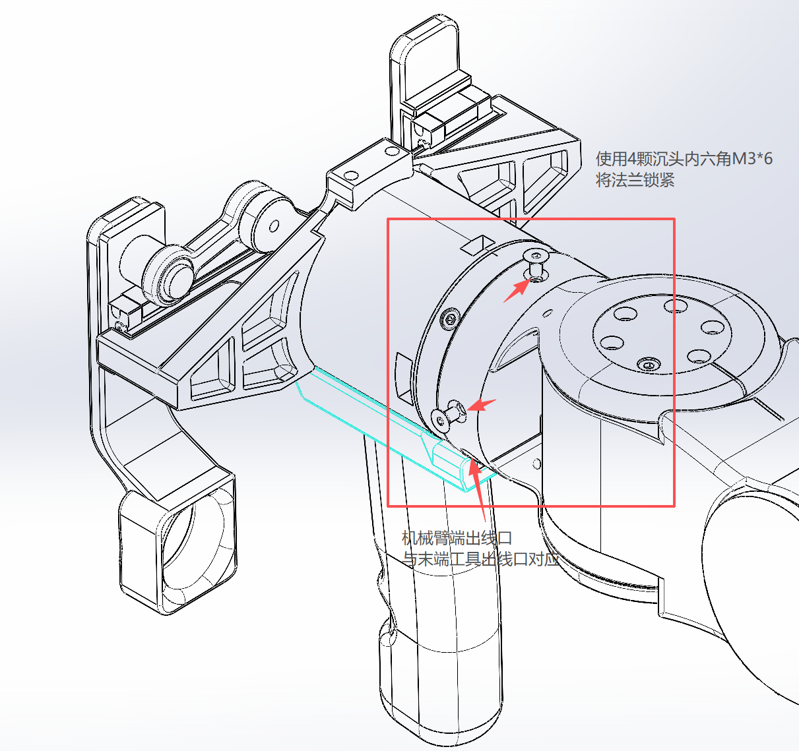
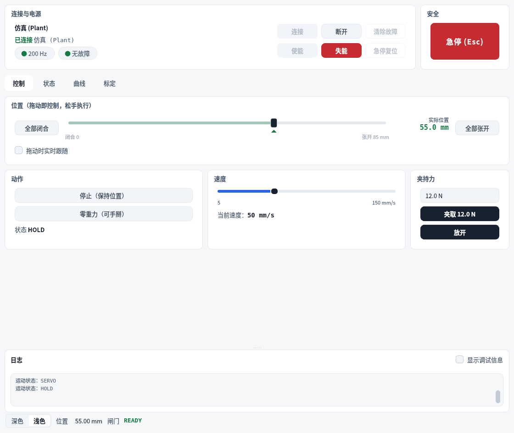
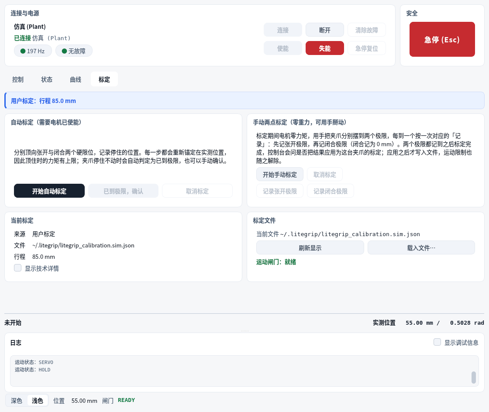
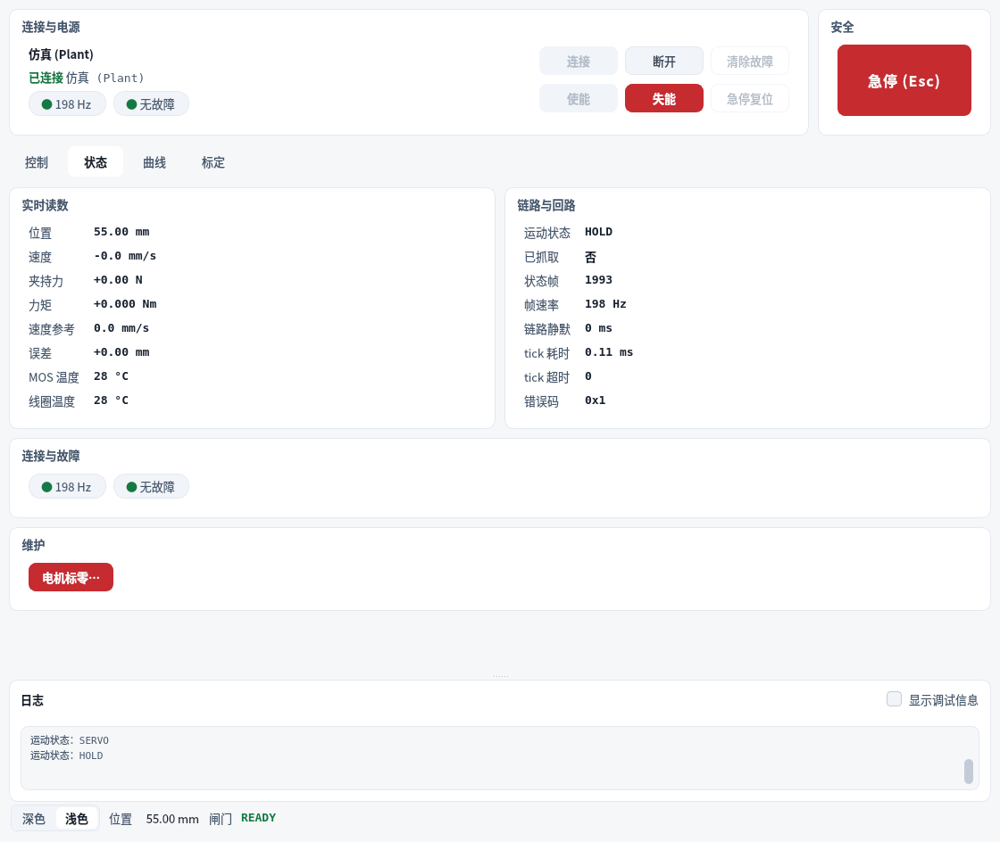
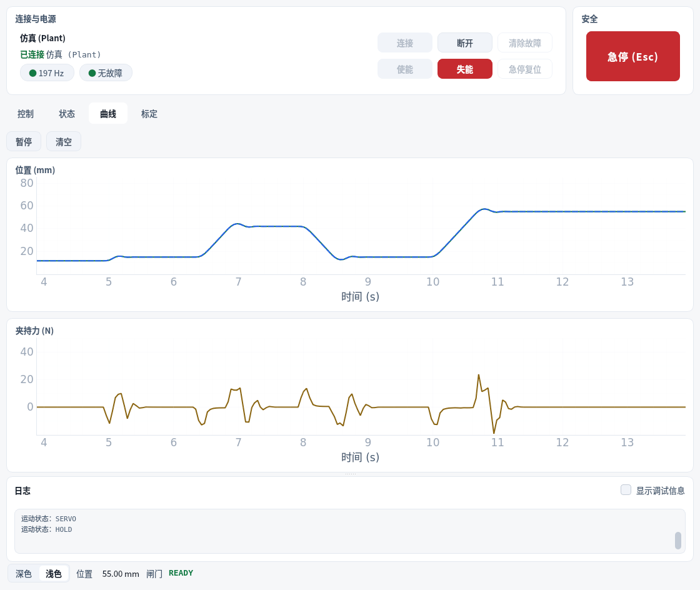

---
revisions:
  - version: V1.0.3
    date: 2026-11-05
    note: 配图改为跟随正文排列，图片不再单独排在整页上
  - version: V1.0.2
    date: 2026-11-04
    note: 删除占位配图，按实际发货配置与内置终端电阻修订接线说明
  - version: V1.0.1
    date: 2026-11-04
    note: 补充夹爪与夹持器安装到机械臂末端法兰的安装方式截图
  - version: V1.0.0
    date: 2026-11-03
    note: 新建 LiteGrip 使用教程
---

# 前言

第一次拿到一台 LiteGrip 夹爪，需要经过哪些步骤，才能让它真正动起来？对于刚接触夹爪的开发者、工程师与机器人爱好者而言，上手阶段的目标往往不是写代码，而是先把设备安全、牢固地装好并连通。

本教程以 LiteGrip 自适应两指平动夹爪为对象，覆盖从开箱清点、机械安装、电气连接，到上位机安装、连接真机与首次使用的完整流程。请在安装前仔细阅读本教程，并核对装箱部件是否齐全。

安装顺序是**先装好夹爪，再接电接线**。夹爪在装配过程中需要翻转、对孔、拧紧，先完成这些动作再接线，线缆不会在装配途中被牵拉，也不会被夹指的运动范围卷入。

**关键词**：夹爪安装，开箱清点，24 V 供电，CAN 总线，LiteGrip Studio，首次使用，标定

## 阅读路径

按顺序阅读即可，全部章节都需要完成。第 6 章 Q&A 按需查阅。

| 章节 | 内容 | 说明 |
| --- | --- | --- |
| 1 | 前言 | 必读 |
| 2 | 开箱清点：确认部件是否齐全 | 必读 |
| 3 | 安装：将夹爪固定到支架或机械臂末端 | 必读 |
| 4 | 电气连接：接通 24 V 供电与 CAN 总线 | 必读 |
| 5 | 上位机：安装 LiteGrip Studio | 必读 |
| 6 | 连接真机与首次使用 | 必读 |
| 7 | Q&A：常见问题 | 选读 |

# 开箱清点：确认部件是否齐全

在开始安装之前，请先核对包装内的夹爪与配件是否齐全。装箱清单如下，最终以随货配置清单为准：

- LiteGrip 夹爪本体一只（含驱动电机、传动机构、两根夹指与指尖，内部已带 120 Ω 终端电阻）
- 夹持器（仅下单「夹爪 + 夹持器」配置时随货提供）
- 出厂标定文件（随 SDK 包提供）

以下设备需要另行准备：

- **24 V 直流电源**：为电机供电。按峰值电流 16.5 A 估算，建议不低于 400 W；典型工况约需 75 W。
- **USB-CAN 适配器**：连接夹爪与上位机。
- **Linux 上位机**：需要内核支持 SocketCAN。
- **安装螺栓与支架**：2 颗 M3 螺栓（安装孔距 15 mm），以及刚性足够的支架或机械臂末端法兰。

清点时请注意以下几点：

- 请先确认包装与夹爪外观有无明显破损、变形或碰伤。
- 建议先完成清点，暂不要接通电源。
- 若发现部件缺失或损坏，请先联系售后处理，请勿使用非配套零件强行安装。

〔配图待补〕开箱清点：夹爪本体、夹持器（如随货）与随货单据

<!-- 图片就位后，把上面这一行换成图片，文件放在 images/fig01-unboxing.png -->

# 安装：将夹爪固定到支架或机械臂末端

夹爪在运动过程中会产生惯性与反作用力。若固定不牢，运动时可能导致位移或振动，影响抓取精度，甚至带来安全风险。因此在进行后续通电与动作测试之前，应先将夹爪固定在稳定的安装位置上。

**步骤 1**：核对外观。检查夹爪本体、夹指与指尖有无变形、碰伤或异物。

〔配图待补〕夹爪外观与部件：夹指、指尖与出线口

<!-- 图片就位后，把上面这一行换成图片，文件放在 images/fig02-appearance.png -->

**步骤 2**：手动推动夹指，确认左右夹指沿导轨平动顺畅、无卡滞，且全行程内没有干涉物。

**步骤 3**：将夹爪安装在刚性足够的支架上。安装面应平整，使用 2 颗 M3 螺栓（孔距 15 mm）固定，拧紧时让螺栓均匀受力。

**步骤 3b｜直接安装到机械臂末端法兰**：若将夹爪直接装到 LITEARM-SE 末端法兰，先让机械臂末端出线槽与夹爪出线槽对齐，再使用 4 颗沉头内六角 M3×6 螺钉锁紧法兰，对角交替拧紧。夹持器装配体的安装方式相同。




**步骤 4**：安装后再次确认夹指运动范围内没有干涉物，线缆已避开运动范围。

> **注意**：夹爪张开方向有机械挡块，闭合方向没有。闭合时两指直接接触，不要指望用闭合动作把某个零件压到定位面；要让夹爪保持夹持，请用力矩控制，不要用位置指令顶死。

> **注意**：安装或拆卸前必须切断 24 V 电源。安装孔位见《产品手册》的「尺寸与安装接口」，线缆与连接器规格请联系我们索取。

> **建议**：拧紧螺栓时，先让全部螺栓对正孔位，再依次拧紧，避免单颗螺栓一次拧死导致其余螺栓难以对正。

# 电气连接：接通 24 V 供电与 CAN 总线

LiteGrip 的对外接口由两组连线构成：24 V 电源与 CAN 总线。夹爪内部已带 120 Ω 终端电阻，接线时不需要再外接。建议在完全断电的状态下完成全部接线，最后再接入电源。

| 连线 | 说明 |
| --- | --- |
| 24 V 电源 | 为电机供电；未接通时电机不输出力矩 |
| CAN 总线 | 连接夹爪与 USB-CAN 适配器，包括 CAN_H 与 CAN_L |

**步骤 1**：连接 24 V 电源。上电前用万用表确认极性，电源应具备过流与短路保护。

**步骤 2**：将夹爪的 CAN_H、CAN_L 接到 USB-CAN 适配器。

**步骤 3**：用 USB 线将 USB-CAN 适配器连接到上位机。

〔配图待补〕电气连接示意：24 V 电源、CAN_H / CAN_L 与 USB-CAN 适配器（夹爪内置 120 Ω 终端电阻）

<!-- 图片就位后，把上面这一行换成图片，文件放在 images/fig04-wiring.png -->

## 上电顺序

1. 确认接线正确、无短路。
2. 接通 USB-CAN 适配器。
3. 最后接通 24 V 电源。

断开时顺序相反：先断 24 V，再断适配器。

## 接线自检

在接入电源之前，请逐条确认：

- 24 V 电源极性正确，电源具备过流与短路保护。
- CAN_H、CAN_L 未接反，连接器插接到位、无松动。
- 夹爪内部已带 120 Ω 终端电阻，没有在外部重复接入终端电阻。
- 线缆走向已整理，不会进入夹指的运动范围。
- 全部确认无误后，再按上电顺序接通电源。

> **注意**：CAN FD 必须显式关闭。接口以 FD 模式打开时，即使波特率正确也无法通信，而且这个现象很像「没接 24 V」，容易被误判成硬件故障。

> **注意**：只接 USB-CAN 适配器、未接 24 V 时，夹爪能通信、能读状态，但不会动，并报告欠压故障（错误码 0x9）。这是正常现象，不是故障。

# 上位机：安装 LiteGrip Studio

LiteGrip Studio 是目前最省事的操作方式：连接、使能、查看状态与曲线都在图形界面里完成。它目前只提供源码，运行在 Linux 上位机上。

## 安装依赖

需要 Python 3.10 或更高版本，以及 PyQt5、pyqtgraph、numpy 三个库：

```bash
git clone https://github.com/nexform-tech/litegrip-studio.git
cd litegrip-studio
python3 -m pip install PyQt5 pyqtgraph numpy
```

不要用 `pip install -e .` 安装本仓库，`pyproject.toml` 里的版本号是发布占位符，不是合法的 PEP 440 版本号。SDK 已随仓库放在 `src/litegrip`，不需要另外安装。

## 先用仿真验证安装

没接夹爪时，LiteGrip Studio 会运行内置的仿真夹爪，每一个控件都照常工作。建议先跑一次仿真，确认安装没有问题：

```bash
./run_litegrip_studio.sh sim
```

打开后顶栏显示「已连接仿真」，四个页签「控制 / 状态 / 曲线 / 标定」都能操作。真机使用同一套界面，只是把 `sim` 换成 `gui`。



# 连接真机与首次使用

## 配置 CAN 接口

Linux 下使用 SocketCAN，经典 CAN、1 Mbps，并显式关闭 CAN FD。以下命令每次开机后执行一次：

```bash
sudo ip link set can0 down
sudo ip link set can0 type can bitrate 1000000 fd off
sudo ip link set can0 up
```

## 启动真机控制台

```bash
./run_litegrip_studio.sh gui
```

默认使用 `can0`；其他接口用 `--can-channel can1` 指定。

## 连接与使能

**步骤 1**：接通 24 V 电源，顶栏点「连接」。

**步骤 2**：点「使能」。使能后电机才会输出力矩；未使能时夹指不会动。

**步骤 3**：确认状态栏显示「闸门 READY」、「无故障」，状态页的位置读数正常。

## 关于标定：默认不需要

**上位机启动时使用随货提供的出厂标定文件，接上真机、连接、使能之后就可以直接使用，默认不需要重新标定。**

只有在使用中感觉夹爪不顺畅时，才需要重新标定，例如：

- 位置读数与卡尺量到的开口对不上；
- 全开或全闭时到不了行程两端；
- 动作卡顿、异响，或夹取时松紧不稳定。

需要时打开「标定」页，在电机已使能的条件下按「开始自动标定」，按提示确认「已到张开极限」与「已到闭合极限」，即可用属于你这台夹爪的数据替换出厂值。标定流程的完整说明见《LiteGrip Studio 操作手册》的「标定」一节。



## 用 Studio 动一下

回到「控制」页：

- 拖动位置滑块，或点「全部张开 / 全部闭合」；「夹取」按设定的夹持力闭合并保持，「放开」释放。
- 速度与夹持力在页面下方可调，运动范围为 0 ~ 85 mm。
- 「状态」页查看实时位置、速度、夹持力、温度与错误码。
- 「曲线」页记录位置、目标位置和夹持力随时间的变化，可用来确认动作是否平滑。
- 右上角「急停 (Esc)」在任何页签下都能按，按下后立即失能并闩锁。





> **警告**：夹爪闭合方向没有机械挡块，夹持请用力矩控制，不要用位置指令顶死。急停必须由硬件回路实现：切断 24 V 动力电，或在上位机之外串一个独立的急停回路。

# Q&A

**问：只接 USB-CAN、不接 24 V 电源，夹爪能动吗？**
答：不能。只接适配器时夹爪能通信、能读状态，但电机不输出力矩，并会报告欠压故障（错误码 0x9）。这是正常现象，接通 24 V 即可。

**问：上电后完全无法通信？**
答：依次检查：CAN 接口是否已用 `ip link` 配置并 `up`；是否显式关闭了 CAN FD；连接器是否插到位。夹爪内部已带 120 Ω 终端电阻，不要在总线上再外接终端电阻，否则会因重复终端导致通信时通时断。

**问：能读状态但夹爪不动？**
答：最常见的原因是 24 V 电源未接通；其次是电机未使能。若界面提示运动闸门为「已阻断」，说明没有可用标定，请重新加载出厂标定文件或执行一次标定。

**问：第一次使用需要标定吗？**
答：不需要。上位机默认加载随货的出厂标定文件，连接并使能后即可直接使用。只有在感觉夹爪使用不顺畅（读数与卡尺不符、到不了行程两端、动作卡顿或夹取松紧不稳定）时，再到「标定」页重新标定。

**问：夹爪开口多大？**
答：有效行程 85.000 mm。位置 `p` 从完全闭合端的 0 到完全张开端的 85.000，全行程可用，而且 `p` 就是卡尺量到的开口；单指行程为 42.500 mm。

**问：为什么张开时停在 80 mm，而不是 85 mm？**
答：随包标定把工作行程设为 80 mm，因此默认的 `open()` 停在 80 mm，不会碰到张开侧机械挡块。需要完全张开时，在控制页把滑块拖到底，或用 SDK 的 `goto(85.0)`。

**问：夹取和闭合有什么区别？**
答：「夹取」按设定的夹持力闭合并保持，夹住物体或顶到行程端点都算成功；「闭合」则一直顶到闭合侧限位，半路夹到物体会报告失败。需要保持夹持时请用「夹取」。

**问：怎么让夹爪紧急停止？**
答：按右上角「急停 (Esc)」，夹爪立即失能并闩锁，复位前拒绝一切运动。但软件急停不能替代硬件急停：涉及人员安全的场合，请切断 24 V 动力电，或在上位机之外串一个独立的急停回路。

**问：断电后夹爪会松开吗？**
答：会。本产品无断电自锁，断电后失去保持力矩。若应用场合不允许断电后松脱，必须另加机械保持装置。

**问：支持 Windows 或 macOS 上位机吗？**
答：不支持。LiteGrip Studio 与 SDK 目前仅支持 Linux，CAN 接口使用 SocketCAN。

**问：没有上位机，能用 SDK 控制吗？**
答：可以。Python SDK 已发布到 PyPI（`pip install litegrip-python`），安装、接口与示例见《软件开发手册》。运动之前必须先加载标定，没有标定时 `open()`、`close()`、`grasp()` 都会抛出异常。

**问：夹爪防水防尘吗？**
答：IP 等级尚未认证。在有粉尘、水汽或切削液的环境中使用前请先联系我们。

**问：需要重新标定的情况有哪些？**
答：更换夹爪本体或电机、更换或维修夹指、发生碰撞或过载、断电后位置读数异常，以及日常使用中感觉动作不顺畅时。

**问：技术支持渠道？**
答：NEXFORM ROBOTICS 技术团队。可通过 GitHub Issues（litegrip-python、litegrip-studio、litegrip-docs）反馈，或联系随货单据与销售渠道提供的对接人。

感谢您选用 LiteGrip 夹爪，祝您使用顺利。产品资料、软件更新与问题反馈，请访问公司代码仓库：<https://github.com/nexform-tech>。
