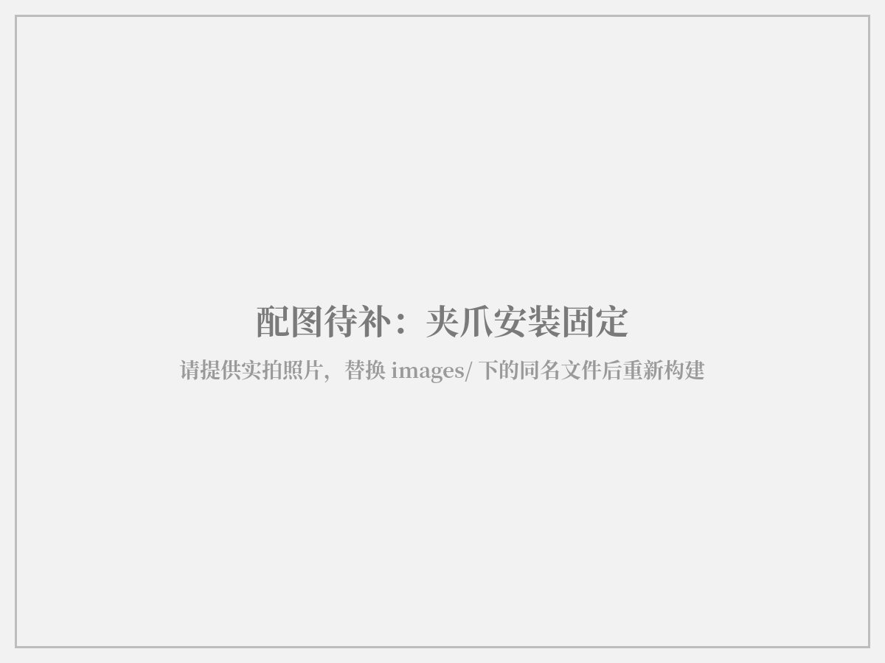
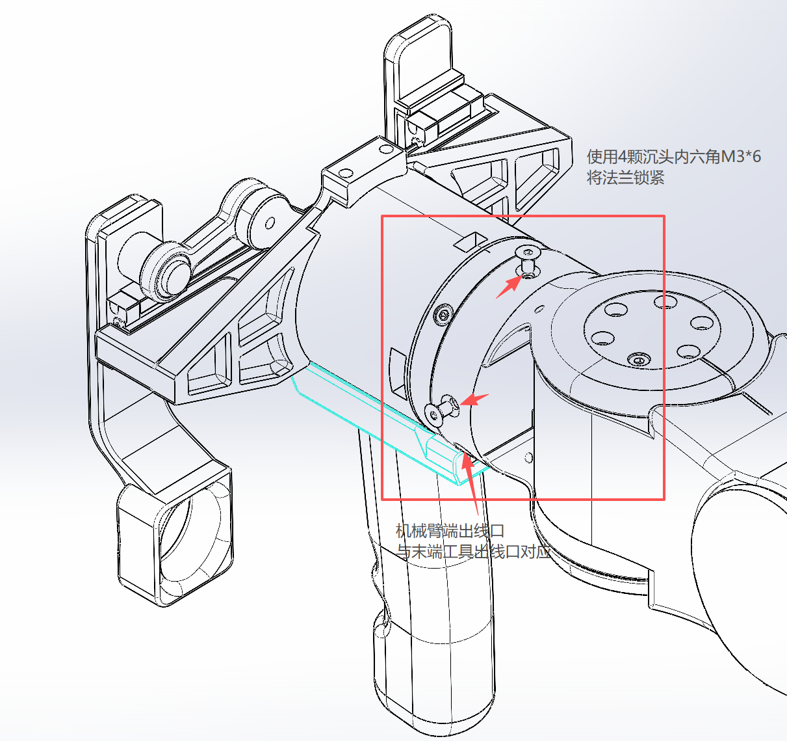
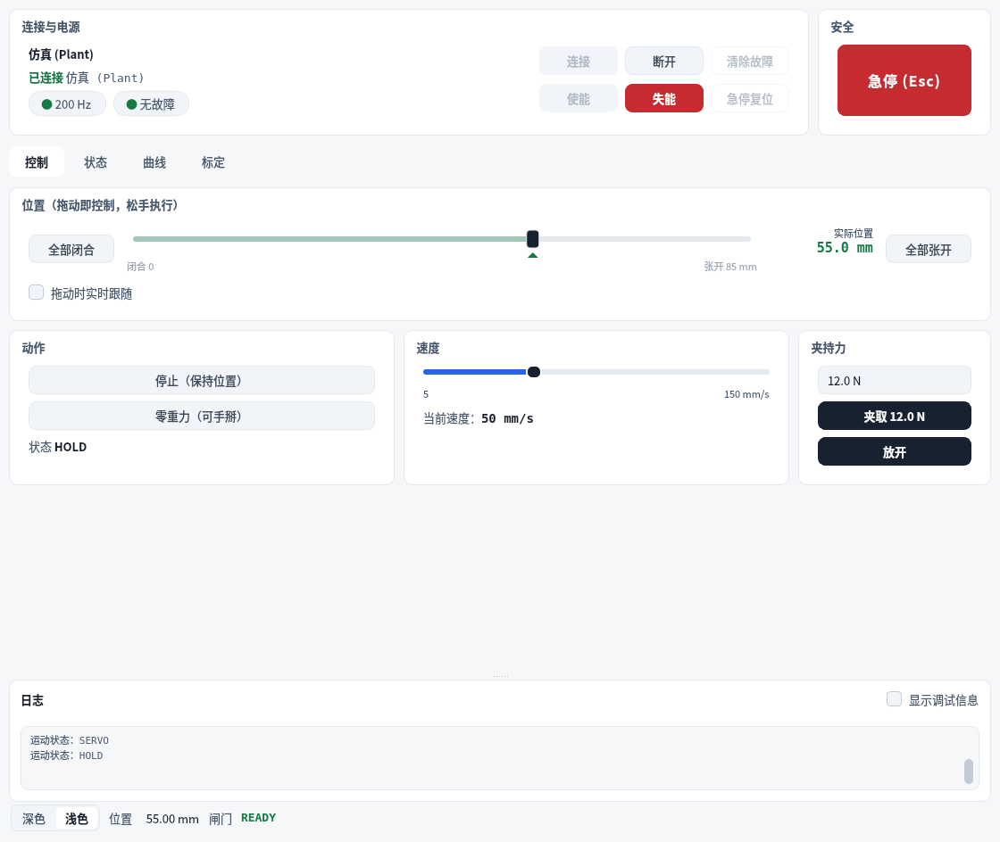
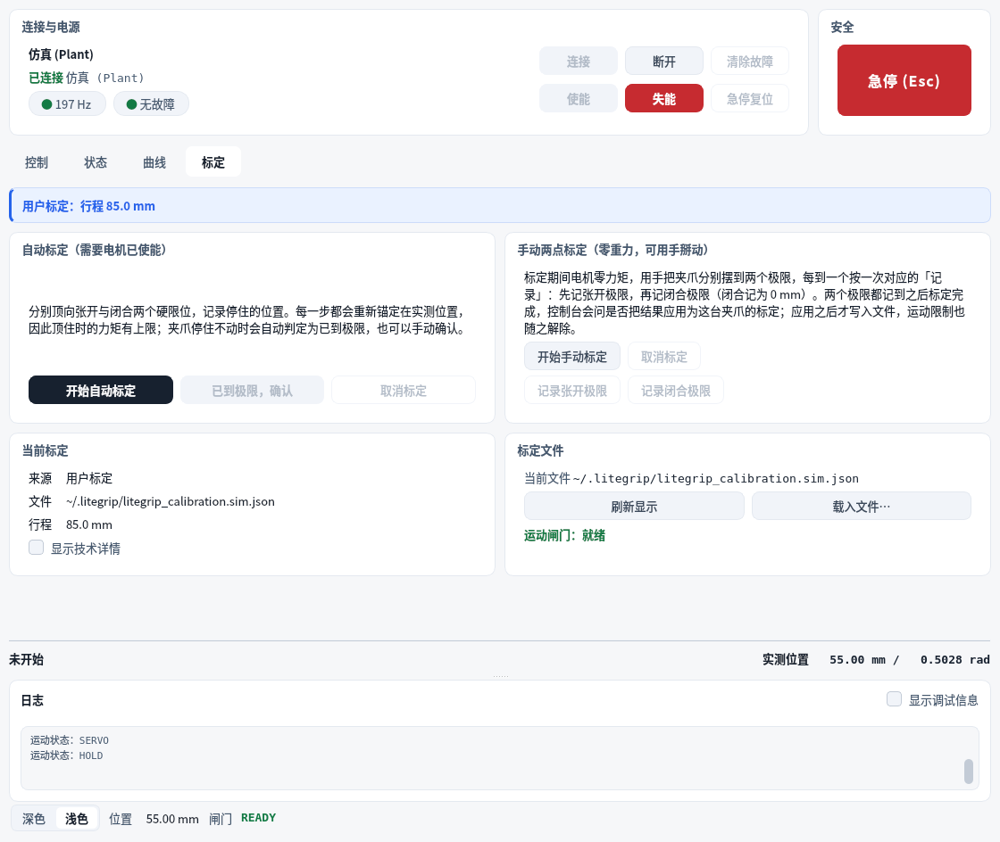
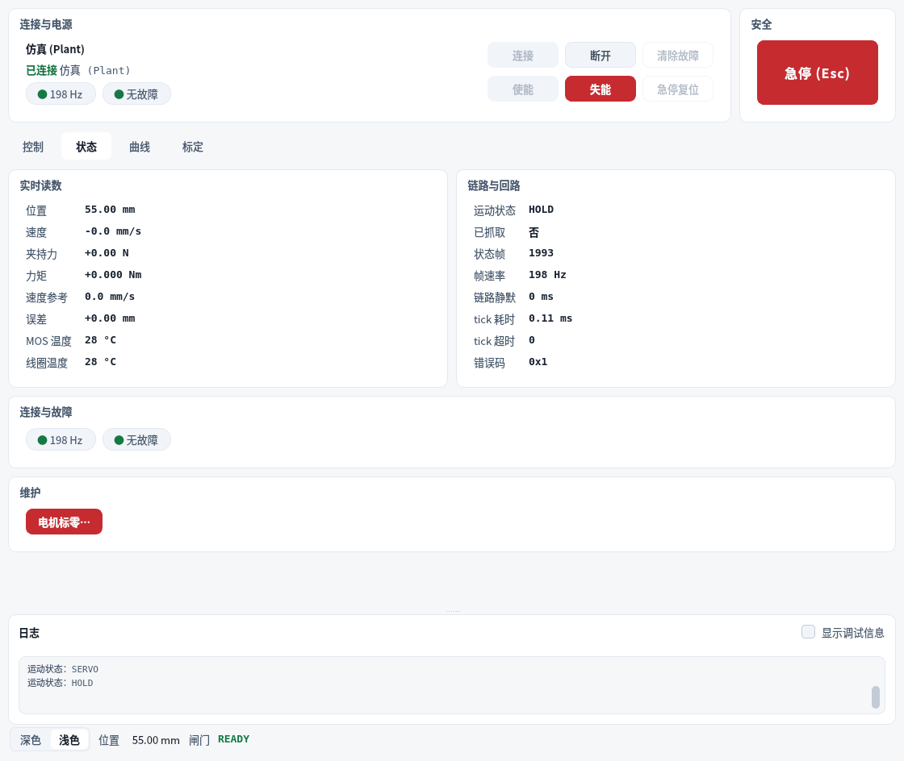
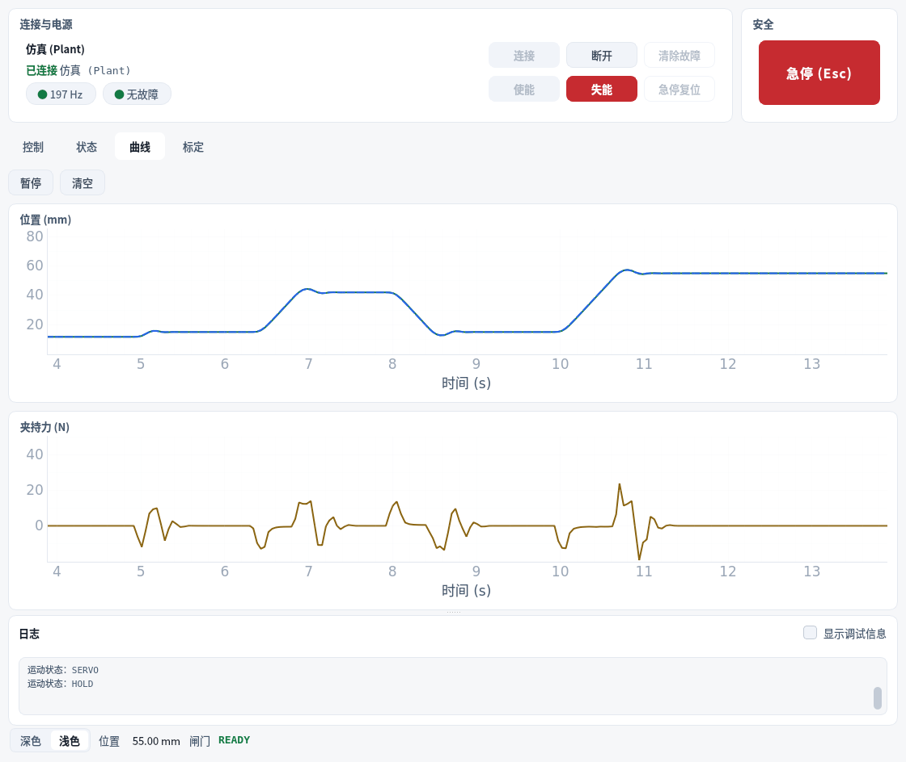

---
revisions:
  - version: V1.0.3
    date: 2026-11-05
    note: Each figure now sits with the text it illustrates instead of on a page of its own
  - version: V1.0.2
    date: 2026-11-04
    note: Removed placeholder figures and revised the wiring instructions to match the actual shipped configuration and built-in terminator
  - version: V1.0.1
    date: 2026-11-04
    note: Added screenshots of how to mount the gripper and holder to the robot arm end flange
  - version: V1.0.0
    date: 2026-11-03
    note: Created the LiteGrip usage tutorial
---

# Preface

When you receive a LiteGrip gripper for the first time, what steps are needed to get it actually moving? For developers, engineers and robot enthusiasts who are new to grippers, the goal at the onboarding stage is often not to write code, but to first install the device safely and firmly and get it connected.

This tutorial focuses on the LiteGrip adaptive two-finger parallel gripper and covers the complete process from unboxing inventory, mechanical installation and electrical connection through to host computer installation, connecting to the real device and first use. Please read this tutorial carefully before installation and check that all boxed parts are present.

The installation order is **install the gripper first, then connect power and wiring**. During assembly the gripper needs to be flipped, aligned with holes and tightened; completing these actions before wiring means the cables will not be pulled during assembly or caught in the jaws' range of motion.

**Keywords**: gripper installation, unboxing inventory, 24 V power supply, CAN bus, LiteGrip Studio, first use, calibration

## Reading path

Read in order; all chapters need to be completed. Consult Chapter 6 Q&A as needed.

| Chapter | Content | Note |
| --- | --- | --- |
| 1 | Preface | Required |
| 2 | Unboxing inventory: confirm all parts are present | Required |
| 3 | Installation: secure the gripper to the bracket or robot arm end | Required |
| 4 | Electrical connection: connect 24 V power and CAN bus | Required |
| 5 | Host computer: install LiteGrip Studio | Required |
| 6 | Connecting the real device and first use | Required |
| 7 | Q&A: frequently asked questions | Optional |

# Unboxing inventory: confirm all parts are present

Before starting installation, please check that the gripper and accessories in the package are complete. The packing list is as follows; the configuration list shipped with the goods prevails.

- One LiteGrip gripper body (including drive motor, transmission mechanism, two jaws and jaw tips; 120 Ω terminator built in)
- Holder (supplied only when the "gripper + holder" configuration is ordered)
- Factory calibration file (provided with the SDK package)

The following equipment must be prepared separately:

- **24 V DC power supply**: powers the motor. Estimated at a peak current of 16.5 A, at least 400 W is recommended; typical working conditions require about 75 W.
- **USB-CAN adapter**: connects the gripper to the host computer.
- **Linux host computer**: the kernel must support SocketCAN.
- **Mounting bolts and bracket**: 2 M3 bolts (mounting hole spacing 15 mm), plus a sufficiently rigid bracket or robot arm end flange.

During the inventory, note the following:

- First confirm that the packaging and the gripper's exterior show no obvious damage, deformation or dents.
- Complete the inventory first and do not connect power yet.
- If any part is missing or damaged, contact after-sales support first; do not force installation with non-matching parts.

[Figure to be added] Unboxing inventory: gripper body, holder (if included) and accompanying documents

<!-- 图片就位后，把上面这一行换成图片，文件放在 images/fig01-unboxing.png -->

# Installation: secure the gripper to the bracket or robot arm end

The gripper generates inertia and reaction forces during motion. If it is not securely fixed, it may shift or vibrate during motion, affecting gripping accuracy and even posing a safety risk. Therefore, before the subsequent power-on and motion tests, the gripper should be fixed in a stable mounting position.

**Step 1**: Check the exterior. Inspect the gripper body, jaws and jaw tips for deformation, dents or foreign matter.

[Figure to be added] Gripper exterior and parts: jaws, jaw tips and cable outlet

<!-- 图片就位后，把上面这一行换成图片，文件放在 images/fig02-appearance.png -->

**Step 2**: Push the jaws by hand and confirm that the left and right jaws slide smoothly along the guide rails without sticking, and that there are no obstructions anywhere in the stroke.

**Step 3**: Mount the gripper on a sufficiently rigid bracket. The mounting surface should be flat; secure it with 2 M3 bolts (hole spacing 15 mm) and tighten them so the bolts are loaded evenly.

**Step 3b | Mounting directly to the robot arm end flange**: If mounting the gripper directly to the LITEARM-SE end flange, first align the cable slot on the robot arm end with the cable slot on the gripper, then lock the flange with 4 countersunk hex M3×6 screws, tightening them diagonally in alternation. The holder assembly is mounted in the same way.





**Step 4**: After installation, once again confirm that there are no obstructions within the jaws' range of motion and that the cables are clear of it.

> **Caution**: There is a mechanical stop in the opening direction of the gripper, but none in the closing direction. When closing, the two jaws touch directly; do not expect the closing motion to press a part against a locating surface. To keep the gripper holding, use force control, not a position command pushed to the limit.

> **Caution**: The 24 V power must be cut off before installation or removal. For mounting hole positions, see "Dimensions and Mounting Interface" in the Product Manual; for cable and connector specifications, contact us.

> **Recommendation**: When tightening the bolts, first align all bolts with their holes, then tighten them in sequence, to avoid one bolt being fully tightened and making the others hard to align.

# Electrical connection: connect 24 V power and CAN bus

The external interfaces of LiteGrip consist of two sets of connections: 24 V power and CAN bus. A 120 Ω terminator is built into the gripper, so no external terminator is needed when wiring. Complete all wiring with the power fully disconnected, and connect the power supply last.

| Connection | Description |
| --- | --- |
| 24 V power | Powers the motor; the motor outputs no torque when it is not connected |
| CAN bus | Connects the gripper to the USB-CAN adapter; includes CAN_H and CAN_L |

**Step 1**: Connect the 24 V power supply. Before powering up, confirm the polarity with a multimeter; the power supply should have overcurrent and short-circuit protection.

**Step 2**: Connect the gripper's CAN_H and CAN_L to the USB-CAN adapter.

**Step 3**: Connect the USB-CAN adapter to the host computer with a USB cable.

[Figure to be added] Wiring diagram: 24 V power supply, CAN_H / CAN_L and USB-CAN adapter (120 Ω terminator built into the gripper)

<!-- 图片就位后，把上面这一行换成图片，文件放在 images/fig04-wiring.png -->

## Power-up sequence

1. Confirm the wiring is correct and there is no short circuit.
2. Connect the USB-CAN adapter.
3. Connect the 24 V power supply last.

To disconnect, reverse the order: cut the 24 V first, then disconnect the adapter.

## Wiring self-check

Before connecting the power, confirm each item:

- The 24 V power polarity is correct, and the power supply has overcurrent and short-circuit protection.
- CAN_H and CAN_L are not swapped; the connector is fully seated and not loose.
- The 120 Ω terminator is built into the gripper; no terminator has been added again externally.
- The cable routing has been tidied and will not enter the jaws' range of motion.
- Only after everything is confirmed, connect the power following the power-up sequence.

> **Caution**: CAN FD must be explicitly disabled. If the interface is opened in FD mode, communication will fail even if the bitrate is correct, and this symptom closely resembles "24 V not connected", making it easy to misdiagnose as a hardware fault.

> **Caution**: With only the USB-CAN adapter connected and no 24 V, the gripper can communicate and read status but will not move, and it reports an undervoltage fault (error code 0x9). This is normal, not a fault.

# Host computer: install LiteGrip Studio

LiteGrip Studio is currently the most convenient way to operate the gripper: connecting, enabling, viewing status and curves are all done in a graphical interface. It is currently provided only as source code and runs on a Linux host computer.

## Install dependencies

Python 3.10 or later is required, along with the three libraries PyQt5, pyqtgraph and numpy:

```bash
git clone https://github.com/nexform-tech/litegrip-studio.git
cd litegrip-studio
python3 -m pip install PyQt5 pyqtgraph numpy
```

Do not install this repository with `pip install -e .`; the version number in `pyproject.toml` is a release placeholder, not a valid PEP 440 version. The SDK is already included in the repository under `src/litegrip` and does not need to be installed separately.

## Verify the installation with simulation first

When no gripper is connected, LiteGrip Studio runs a built-in simulated gripper, and every control works as usual. It is recommended to run the simulation once first to confirm the installation is fine:

```bash
./run_litegrip_studio.sh sim
```

After it opens, the top bar shows "Simulation connected", and all four tabs "Control / Status / Curves / Calibration" can be operated. The real device uses the same interface; just replace `sim` with `gui`.



# Connecting the real device and first use

## Configure the CAN interface

On Linux, use SocketCAN, classic CAN, 1 Mbps, with CAN FD explicitly disabled. Run the following commands once after each boot:

```bash
sudo ip link set can0 down
sudo ip link set can0 type can bitrate 1000000 fd off
sudo ip link set can0 up
```

## Start the real-device console

```bash
./run_litegrip_studio.sh gui
```

The default is `can0`; for other interfaces, specify one with `--can-channel can1`.

## Connect and enable

**Step 1**: Connect the 24 V power supply and click "Connect" in the top bar.

**Step 2**: Click "Enable". The motor outputs torque only after enabling; the jaws will not move when not enabled.

**Step 3**: Confirm the status bar shows "Gate READY" and "No faults", and that the position reading on the Status page is normal.

## About calibration: not needed by default

**The host computer loads the factory calibration file shipped with the product at startup. Once the real device is connected and enabled, it can be used directly; recalibration is not needed by default.**

Recalibrate only when the gripper feels unsmooth in use, for example:

- The position reading does not match the opening measured with calipers;
- It cannot reach either end of the stroke when fully open or fully closed;
- Motion is jerky or noisy, or the grip tightness is unstable when grasping.

When needed, open the "Calibration" page, and with the motor enabled press "Start Auto Calibration", then confirm "Open limit reached" and "Closed limit reached" as prompted; the data for your gripper will then replace the factory values. For the full description of the calibration procedure, see the "Calibration" section of the LiteGrip Studio Operation Manual.



## Move it with Studio

Return to the "Control" page:

- Drag the position slider, or click "Open All / Close All"; "Grasp" closes with the configured gripping force and holds, while "Release" releases.
- Speed and gripping force can be adjusted at the bottom of the page; the motion range is 0 ~ 85 mm.
- The "Status" page shows real-time position, speed, gripping force, temperature and error codes.
- The "Curves" page records the changes in position, target position and gripping force over time, and can be used to confirm whether the motion is smooth.
- The "Emergency Stop (Esc)" in the upper right corner can be pressed on any tab; pressing it immediately disables and latches the gripper.





> **Warning**: There is no mechanical stop in the closing direction of the gripper; use force control for gripping, not a position command pushed to the limit. The emergency stop must be implemented by a hardware circuit: cut the 24 V power, or connect an independent emergency stop circuit in series outside the host computer.

# Q&A

**Q: Can the gripper move with only USB-CAN connected and no 24 V power supply?**
A: No. With only the adapter connected, the gripper can communicate and read status, but the motor outputs no torque and it reports an undervoltage fault (error code 0x9). This is normal; just connect 24 V.

**Q: No communication at all after power-up?**
A: Check in order: whether the CAN interface has been configured with `ip link` and brought `up`; whether CAN FD has been explicitly disabled; whether the connector is fully seated. A 120 Ω terminator is built into the gripper; do not add another terminator on the bus, otherwise duplicate termination will cause intermittent communication.

**Q: It can read status but the gripper does not move?**
A: The most common cause is that the 24 V power supply is not connected; the next is that the motor is not enabled. If the interface indicates that the motion gate is "Blocked", there is no usable calibration; reload the factory calibration file or run a calibration.

**Q: Is calibration needed for first use?**
A: No. The host computer loads the factory calibration file shipped with the product by default, and the gripper can be used directly after connecting and enabling. Recalibrate on the "Calibration" page only when the gripper feels unsmooth in use (readings do not match calipers, it cannot reach either end of the stroke, motion is jerky, or grip tightness is unstable).

**Q: How large is the gripper opening?**
A: The effective stroke is 85.000 mm. The position `p` runs from 0 at the fully closed end to 85.000 at the fully open end; the full stroke is usable, and `p` is exactly the opening measured with calipers. The per-jaw stroke is 42.500 mm.

**Q: Why does it stop at 80 mm when opening instead of 85 mm?**
A: The bundled calibration sets the working stroke to 80 mm, so the default `open()` stops at 80 mm and does not hit the mechanical stop on the opening side. To open fully, drag the slider to the end on the Control page, or use the SDK's `goto(85.0)`.

**Q: What is the difference between grasping and closing?**
A: "Grasp" closes with the configured gripping force and holds; both gripping an object and reaching the stroke end count as success. "Close" keeps pushing until the closing-side limit, and reports failure if it grips an object partway. Use "Grasp" when you need to hold a grip.

**Q: How do I stop the gripper in an emergency?**
A: Press "Emergency Stop (Esc)" in the upper right corner; the gripper is immediately disabled and latched, and refuses all motion until reset. However, a software emergency stop cannot replace a hardware emergency stop: in situations involving personnel safety, cut the 24 V power, or connect an independent emergency stop circuit in series outside the host computer.

**Q: Will the gripper release if power is lost?**
A: Yes. This product has no power-off self-locking; it loses holding torque when power is lost. If the application does not allow release after power loss, a separate mechanical holding device must be added.

**Q: Are Windows or macOS host computers supported?**
A: No. LiteGrip Studio and the SDK currently support Linux only, and the CAN interface uses SocketCAN.

**Q: Can I control it with the SDK without the host computer?**
A: Yes. The Python SDK has been published to PyPI (`pip install litegrip-python`); for installation, interfaces and examples, see the Software Development Manual. Calibration must be loaded before motion; without calibration, `open()`, `close()` and `grasp()` all throw exceptions.

**Q: Is the gripper waterproof and dustproof?**
A: The IP rating has not yet been certified. Please contact us before using it in environments with dust, moisture or cutting fluid.

**Q: What situations require recalibration?**
A: Replacing the gripper body or motor, replacing or repairing the jaws, a collision or overload, abnormal position readings after power loss, and when motion feels unsmooth during daily use.

**Q: Technical support channels?**
A: The NEXFORM ROBOTICS technical team. You can provide feedback through GitHub Issues (litegrip-python, litegrip-studio, litegrip-docs), or contact the person named in the accompanying documents and the sales channel.

Thank you for choosing the LiteGrip gripper, and we wish you smooth use. For product information, software updates and feedback, please visit the company's code repository: <https://github.com/nexform-tech>.
